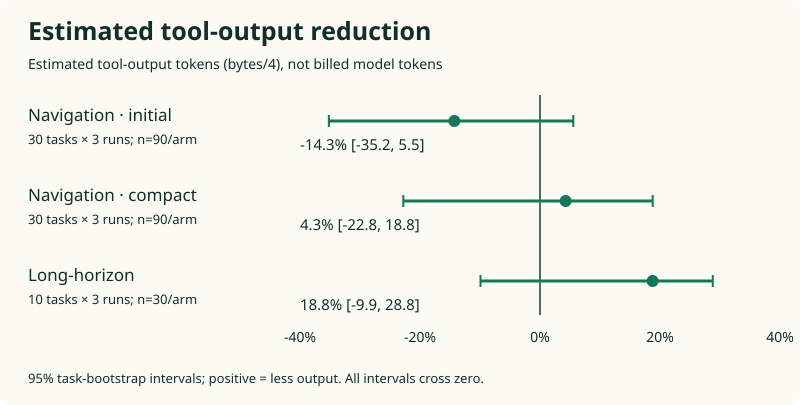
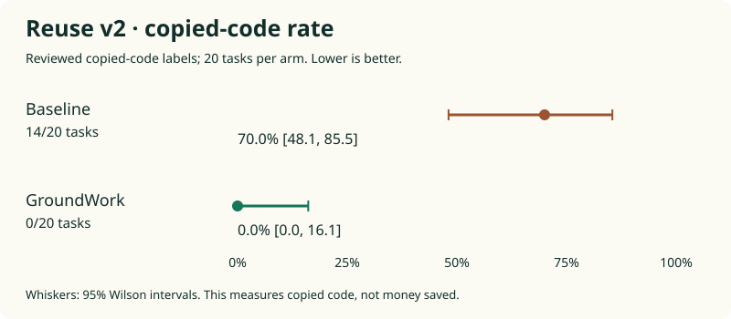
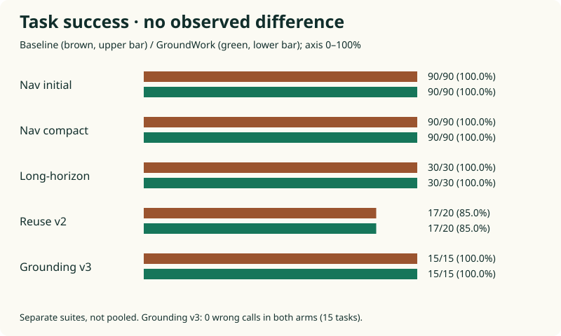
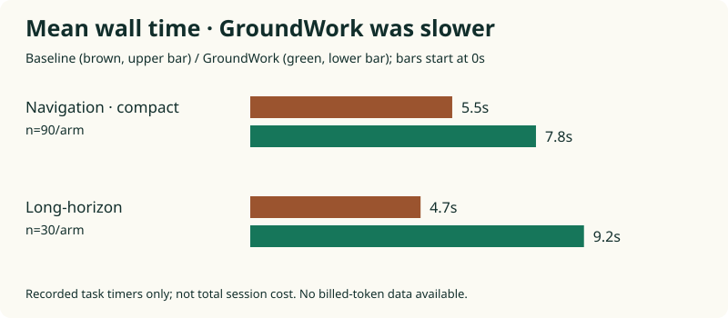
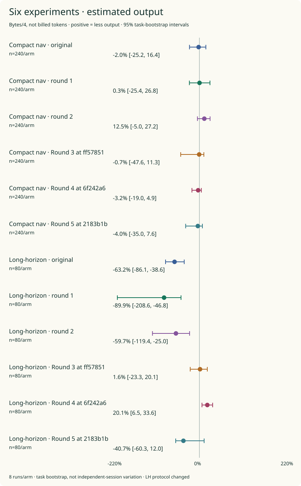
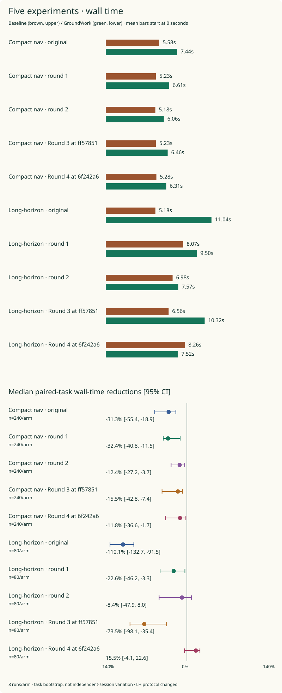
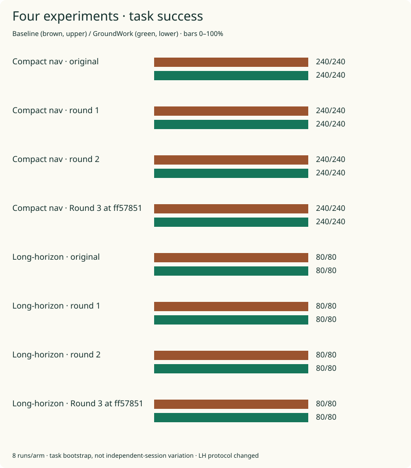

<p align="center">
  <picture>
    <source media="(max-width: 600px)" srcset="docs/assets/groundwork-hero-mobile.webp">
    
  </picture>
</p>

<h1 align="center">Less searching. More building.</h1>

### Search by intent

Use `gw search "where do we retry failed requests" --limit 5` (or `--json`)
and MCP `search_code` when you know what code does but not its name. Results
include symbol IDs, locations, a short doc line and match evidence. Use
`find_code` for known names; it is unchanged. Search normalizes English filler,
inflections and a small code vocabulary. After explicit `gw init --embeddings`
setup, installed local source embeddings augment lexical ranking; otherwise
search silently stays lexical. Runtime never downloads models. The frozen
retrieval evaluation and limitations live in `bench/search/`.

<p align="center">
  A live, local map of your codebase for coding agents.<br>
  Find the right symbol. Reuse the right helper. Call code that actually exists.
</p>

<p align="center">
  <strong>Claude Code · Codex · Cursor</strong><br>
  TypeScript · JavaScript · Python · Go · Rust · Java · C# · Ruby &nbsp; / &nbsp; Node.js 22+ &nbsp; / &nbsp; MIT
</p>

<p align="center">
  <a href="#install"><strong>Get started</strong></a> ·
  <a href="#what-it-does">Why Groundwork</a> ·
  <a href="#see-a-real-check">See a real check</a> ·
  <a href="#how-it-works">How it works</a> ·
  <a href="#learn-more">Docs</a>
</p>

---

Your agent can write code. **Groundwork helps it understand the code you already have.**

Instead of filling the context window with grep results and whole files, the agent gets a ranked map, precise symbol reads, and existing code to reuse. Hooks keep that map current and check new calls against real definitions as the agent works.

**No hosted service. No telemetry. No network access at runtime.**

## Install

Requires **Node.js 22 or later**. Choose an install method:

**Homebrew** installs Node.js too:

```sh
brew install ADITYADEV4145/groundwork/groundwork
```

**npm, pnpm or Bun:**

```sh
npm install -g groundwork-agent
# or
pnpm add -g groundwork-agent
# or
bun add -g groundwork-agent
```

**Install script:**

```sh
curl -fsSL https://raw.githubusercontent.com/ADITYADEV4145/GroundWork/main/scripts/install.sh | sh
```

**One-off, without installing globally:**

```sh
npx groundwork-agent doctor
# or
bunx groundwork-agent doctor
```

**From source:**

```sh
git clone https://github.com/ADITYADEV4145/GroundWork.git
cd GroundWork
npm ci
npm run build
npm link
```

Then, **from the repository you want your agent to work in**:

```sh
gw init       # build the local index in .groundwork/
gw setup      # preview project-level changes, then confirm
```

Restart your agent after setup. Codex asks you to trust the new hooks once, under `/hooks`.

Codex setup also installs the skill and references in `.agents/skills/groundwork/`,
the [repository skill location Codex discovers](https://developers.openai.com/codex/skills/).
Removal preserves pre-existing or subsequently edited skill files.
For a skill-only install (no MCP or hooks), use `npx skills add ADITYADEV4145/GroundWork`;
the repository's root `SKILL.md` and `references/` follow the Agent Skills layout.

Want to see exactly what setup would do first?

```sh
gw setup --dry-run
```

<details>
<summary><strong>Setup options, changed files, and removal</strong></summary>

| Flag | Effect |
| --- | --- |
| `--agent claude,codex,cursor` | Set up only these agents. By default, setup detects installed agents. |
| `--profile minimal\|standard\|strict` | Choose guard behavior. See [Profiles](#profiles). |
| `--dry-run` | Show the plan without writing anything. |
| `--yes` | Apply without asking; required when there is no terminal. |
| `--command "<cmd>"` | Choose how agents launch Groundwork; default: `gw`. |
| `--remove` | Remove what setup added, preserving unrelated settings. |

Setup writes project-level integration files for the agents you select: `.claude/settings.json`, `.mcp.json`, `.codex/hooks.json`, `.codex/config.toml`, `.cursor/hooks.json` and `.cursor/mcp.json`. It preserves existing settings. A selected profile is stored in `.groundwork/config.json`.

To uninstall the integrations, run `gw setup --remove`. To remove the local index and state too, delete `.groundwork/` afterward.

</details>

<details>
<summary><strong>Claude Code plugin and other MCP clients</strong></summary>

These integrations use the `gw` on your PATH from any install above. One-off runs do not put `gw` on PATH:

- **Claude Code plugin:** `/plugin marketplace add ADITYADEV4145/GroundWork`, then `/plugin install groundwork`.
- **Any MCP client:** run `gw mcp` as a stdio server from the repository root.

</details>

## What it does

<picture>
  <source media="(max-width: 600px)" srcset="docs/assets/groundwork-workflow-mobile.webp">
  
</picture>

### One skill. Three better habits.

| Instead of… | Groundwork helps your agent… |
| --- | --- |
| **Searching in circles** — grep loops, whole-file reads, re-reading unchanged code | Navigate a ranked repository map and read just the symbols it needs, within a token budget. Claude Code's read guard catches repeat reads of unchanged ranges. |
| **Writing the same helper twice** — new names for code you already have | Find similar code first and choose `REUSE`, `EXTEND` or `NEW because …`. The change gate flags clones, duplicate constants and files, and code left dead by a change. |
| **Calling code that sounds right** — invented imports, members or arguments | Check edited calls against the index, suggest real definitions, and run the same grounding checks explicitly with `gw verify` or `gw check`. |

Waste guards also catch repeated commands, suggest more focused exploration, and trim noisy command output while retaining failures and a full local log. See [waste guards](docs/waste-guards.md) for the agent-specific behavior and limits.

**Languages:** Indexing, navigation, impact analysis and the reuse gate support TypeScript, JavaScript (including JSX and CommonJS), Python, Go, Rust, Java, C# and Ruby. Grounding call verification remains limited to TypeScript, JavaScript and Python. Other files fall back to the agent's normal tools.

## See a real check

An agent imports `formatCurrency`, but the module exports `formatPrice`. It also passes two arguments to a one-argument function. Groundwork reports both, with the real signature:

```text
$ gw check
BLOCK grounding (unknown-export): label.ts:1
Why: 'formatCurrency' is not exported in money.ts. Did you mean formatPrice (money.ts:1, formatPrice(cents: number): string)?
Fix: Use formatPrice (money.ts:1): formatPrice(cents: number): string.

BLOCK grounding (arity): label.ts:3
Why: formatPrice() takes 1 argument, got 2 — formatPrice(cents: number): string (money.ts:1).
```

**Not a plausible guess: a lookup against your repository.** `gw check` exits with code 1 on BLOCK findings, so you can also use it as a CI gate.

## How it works

<picture>
  <source media="(max-width: 600px)" srcset="docs/assets/architecture-mobile.svg">
  
</picture>

1. **Map once.** `gw init` parses the repository with tree-sitter and stores files, symbols, imports, calls, literals and fingerprints in SQLite (`node:sqlite`, with a `sql.js` fallback).
2. **Navigate precisely.** MCP tools answer with ranked, token-budgeted context. [SKILL.md](SKILL.md) teaches the agent to look for existing code before writing.
3. **Stay current.** Edit hooks reparse changed files, provide grounding notes and run the duplicate gate at Stop. Errors and timeouts fail open so the agent can continue.

### MCP tools

| Tool | What your agent gets |
| --- | --- |
| `repo_map` | A ranked directory tree with top symbols per file; narrow by path. |
| `find_code` | Symbols matching a name or description, with signatures. |
| `outline` | A file's symbols and signatures without their bodies. |
| `read_symbol` | One symbol's source, not the whole file. |
| `callers` / `callees` / `where_used` | Who calls a symbol, what it calls, and its references. |
| `find_similar` | Existing code to consider before writing something new. |
| `refactor_symbol` | Read-only preview of a guarded TS/JS symbol rename or function body edit. |
| `verify_calls` | Whether snippet imports and calls exist, and their argument counts. |
| `index_status` | Index freshness and size. |

Each answer has a token budget. Oversized answers are cut short with a way to fetch the rest.

### Agent support

The map is shared; hook capabilities differ.

| Capability | Claude Code | Codex | Cursor |
| --- | --- | --- | --- |
| MCP navigation and reuse tools | Yes | Yes | Yes |
| Index refresh and grounding notes after edits | Yes | Yes | Yes |
| Unchanged-file read guard | Yes | — | — |
| Automatic noisy-command wrapping | Yes | — | — |
| Stop findings in `standard` | Warnings | Warnings | Not shown |
| Stop gate in `strict` | Once per new finding set | Once per new finding set | Once per new finding set |

Use `gw run -- <cmd>` for explicit output trimming, or `gw check` for explicit change checks, regardless of agent. Cursor's Stop hook cannot show a warning without blocking; use `strict` or run `gw check` yourself there.

## Profiles

Start with `standard`. Tighten the Stop gate only when you want it.

| Profile | What runs | Stop behavior |
| --- | --- | --- |
| `minimal` | Navigation and the read guard where supported. | No duplicate gate. |
| `standard` **(default)** | Adds Reuse First, grounding notes and waste guards. | Findings are warnings; Cursor does not display Stop warnings. |
| `strict` | The same checks as `standard`. | Blocks once per new set of BLOCK findings in a session. |

Choose a profile during setup:

```sh
gw setup --profile strict
```

Or edit `.groundwork/config.json`. Explicit settings override profile defaults:

```json
{
  "profile": "standard",
  "grounding": { "enabled": true },
  "guards": {
    "repeatCommand": { "enabled": false },
    "explorationHint": { "threshold": 20 }
  }
}
```

Commit `config.json` to share your team's preferences. Everything else in `.groundwork/` is git-ignored.

### Change impact

`gw impact [--base ref] [--depth n] [--json]` and MCP `change_impact` list changed
symbols, unchanged callers and reaching tests, with simple high/medium/low risk.
Session evidence marks callers not observed opened/edited and tests not observed
running. Stop adds nonblocking, deduplicated context only; timeouts fail open.
`complete: true` means no further lookup changes the indexed static answer for that
snapshot; ambiguity, stale/unparsed files or depth truncation keep it false.
Configure `impact` (`enabled`, `stopGate`, `depth`, `budgetTokens`, `timeoutMs`).
See [impact rules and limitations](references/impact.md). The deterministic tool
benchmark is not an agent run; the planted-caller agent gate remains pending.

### Optional type checking

`gw types check [files...] [--base ref]` checks changed lines using the target project's
own TypeScript compiler or Pyright (the project's binary, then PATH). Nothing is downloaded;
missing compilers leave syntax/import grounding unchanged and are reported only in explicit
CLI/MCP output. `check_types` accepts `files: [{file, lines?}]` and returns budgeted findings.
`gw check` and Stop include type findings; strict Stop can block new definite errors,
while standard reports context. Existing diagnostics in the base file are informational.
Missing-module TS 2307 diagnostics and diagnostics in files with grounding's
dynamic-patching signals are informational; grounding owns missing-module blocking.
The TypeScript blocking allowlist is 2304, 2305, 2724, 2339, 2551, 2349, 2554,
2555, 2556, 2345, 2353, 2561.
`gw types def|impl|refs file:line:col` provides TypeScript navigation. All support `--json`.

The optional `types` config section defaults to
`{ "enabled": true, "stopGate": true, "postToolHook": false, "timeoutMs": 4000,
"budgetTokens": 400, "typescript": "auto", "python": "auto" }`.
Set `enabled: false` to disable it, or set either language to `"off"`.
Timeouts fail open; type checking is not enabled after individual edits by default.

> The profile controls the **Stop gate**, not every possible intervention. Read and repeat-command guards can deny redundant actions in the profiles where they are enabled; each has an override.

## Commands

| Command | What it does |
| --- | --- |
| `gw symbols <query>` / `gw show <symbol>` | Search symbols; show a signature, callers and callees. |
| `gw similar "<description>"` | Find existing code to reuse. |
| `gw check [--base <ref>]` | Check changed code for duplicates and grounding errors; exit 1 on BLOCK. |
| `gw scan [dir \| diff \| -] [--base <ref>] [--json \| --sarif]` | One-screen report with no setup: invented calls, wrong arguments, duplicated logic, duplicate constants and dead code, plus type errors on the changed lines of a diff. Each finding carries a confidence; low-confidence ones are listed separately under "Check". Exit 1 on a high-confidence finding. |
| `gw receipt [--session <id>] [--png <file>]` | Counts for one agent session: calls checked, invented calls caught, duplicates prevented, callers updated, affected tests run, time added. Counts only, never file names or code. |
| `gw verify [files...]` | Check grounding alone; exit 1 on definite errors. |
| `gw refactor <symbol> --rename <name>` / `--body-file <path>` | Preview a TS/JS symbol rename or body replacement; use `--apply <preview-id>` to revalidate and write. |
| `gw run -- <cmd>` | Keep the full command log locally and print a trimmed summary. |
| `gw report` | Show session guard activity and estimated savings. |
| `gw refresh` / `gw stats` | Refresh the index or inspect its contents. |
| `gw doctor` / `gw selftest` | Check the environment or run acceptance checks. |

Every command accepts `--json`.

### Guarded symbol edits

```sh
gw refactor src/math.ts:formatTotal --rename formatSum --json
gw refactor src/math.ts:formatTotal --rename formatSum --apply <preview-id>
gw refactor src/math.ts:formatSum --body-file /path/to/new-body.txt --json
```

Use an exact symbol ID (from `gw symbols --json`), qualified name, or repo-relative `file:name`. The body file contains the full replacement body, including braces for a block. Groundwork preserves the declaration and edits only the selected body. Rename follows TypeScript's static references, including imports and re-exports, without replacing unrelated names, ordinary strings or comments. It does not update dynamic references or external consumers.

Preview returns a patch in JSON without modifying tracked or untracked source. Groundwork checks for compiler errors and changed bindings, then runs the reuse and grounding checks against isolated copies of the current working tree. A blocking finding, uncheckable target, or stale preview prevents apply; warnings are reported. Apply requires the same request and preview ID, rechecks the candidate, and leaves the patch unstaged. This works in Git repositories with an indexed TS/JS declaration in a compiler project. Rename stops if a source file outside the compiler project may reference the symbol. A body edit must preserve the callable type if the compiler project does not cover all repository TS/JS files. Use ordinary edits and tests for other languages or dynamic references.

## Benchmark results

<!-- stable-protocol:start -->
### v8 (PR #39: fresh-root index cloning + bundled service, not shipped)

V8 publishes the completed v8b recollection: 16 sessions per arm per suite, product and unchanged stable-v1 collector/grader pinned to 243bb549e352ee4a63e968230055cda0c165bbe5. The earlier 3e804c9 run was killed and discarded; none of its captures are included.

| Suite | Estimand | Baseline mean | GroundWork mean | Reduction [95% CI] | Success guardrail |
| --- | --- | --- | --- | --- | --- |
| nav | Session elapsed/task (ms) | 5349.62 | 6321.17 | -18.2% [-27.1, -10.4] | met: 480/480 / 480/480 |
| nav | Emitted bytes/session | 34848.31 | 33048.69 | 5.2% [-3.8, 13.2] | met: 480/480 / 480/480 |
| nav | Tool-side ms/session | 1604.53 | 8739.16 | -444.7% [-501.5, -395.3] | met: 480/480 / 480/480 |
| long-horizon | Session elapsed/task (ms) | 9308.21 | 10814.69 | -16.2% [-28.7, -4.7] | met: 160/160 / 160/160 |
| long-horizon | Emitted bytes/session | 5858.75 | 6774.69 | -15.6% [-40.5, 8.2] | met: 160/160 / 160/160 |
| long-horizon | Tool-side ms/session | 504.32 | 1561.25 | -209.6% [-324.3, -129.9] | met: 160/160 / 160/160 |

Tool-level find_code fell from 434 to 285ms mean per call and LH repo_map from 616 to 337ms (descriptive cross-round), but end to end GroundWork was still significantly slower in both suites: navigation −18.2% [−27.1, −10.4], long-horizon −16.2% [−28.7, −4.7]. Output CIs cross zero in both suites; tool-side time is significantly higher in both. Navigation’s elapsed gap is about 29s per session versus about 7s of additional tool time: most of the loss is outside captured dispatch, in the agent-turn/inter-action portion of the envelope. This residual does not identify model thinking, provider latency or a causal product effect. These product changes were measured and not shipped on main.

Success guardrails are met (480/480 each navigation, 160/160 each LH). Neither suite meets the confirmatory latency-win rule: adjusted 97.5% per-suite lower bounds are −28.35% navigation and −30.45% LH. Positive reduction favors GW; all nominal 95% intervals use the frozen whole-session bootstrap. Equal success is not a correctness win. LH GW16’s 86.216s envelope is complete and valid under the timing rules; it is retained. Tool bytes are not billed tokens or dollar savings.

[Full v8 analysis and tool totals](bench/V8-ANALYSIS.md).

### Stable protocol (v7)

Completed: 16 sessions per arm per suite (64 total), collector 01b1426; product main at e0cad99, experimental read paths off. All submitted sessions are retained.

Pre-registered primary estimands are session elapsed/task (ms), aggregate emitted UTF-8 bytes/session, and total tool-side ms/session. Each metric row reports baseline mean → GroundWork mean and reduction = 100 × (1 − GW mean / baseline mean), with a 95% whole-session bootstrap CI: 10,000 draws per arm, fixed seed 0x51ab17ed. Positive reduction favors GroundWork. Success is a guardrail (no category success drop); confirmatory latency claims also require the protocol’s multiplicity rule. Old median task-window metrics remain secondary.

| Suite | Estimand | Baseline mean | GroundWork mean | Reduction [95% CI] | Success guardrail |
| --- | --- | --- | --- | --- | --- |
| nav | Session elapsed/task (ms) | 5341.10 | 6350.47 | -18.9% [-26.8, -11.2] | met: 480/480 / 480/480 |
| nav | Emitted bytes/session | 33383.56 | 34914.25 | -4.6% [-12.1, 2.3] | met: 480/480 / 480/480 |
| nav | Tool-side ms/session | 1599.86 | 10774.70 | -573.5% [-646.7, -503.6] | met: 480/480 / 480/480 |
| long-horizon | Session elapsed/task (ms) | 9836.58 | 10536.84 | -7.1% [-19.7, 3.9] | met: 160/160 / 160/160 |
| long-horizon | Emitted bytes/session | 5816.06 | 6858.38 | -17.9% [-27.6, -8.7] | met: 160/160 / 160/160 |
| long-horizon | Tool-side ms/session | 523.46 | 1253.07 | -139.4% [-206.7, -88.9] | met: 160/160 / 160/160 |

nav: session elapsed increased cost (nominal 95% CI excludes zero); emitted output inconclusive (95% CI includes zero); tool-side time increased cost (nominal 95% CI excludes zero). Success guardrail met. Multiplicity-adjusted latency lower bound: -27.9%; no confirmatory latency win. long-horizon: session elapsed inconclusive (95% CI includes zero); emitted output increased cost (nominal 95% CI excludes zero); tool-side time increased cost (nominal 95% CI excludes zero). Success guardrail met. Multiplicity-adjusted latency lower bound: -21.6%; no confirmatory latency win.

V7 workflow notes (64 reviewed, including all 10 mentioning failed/error): early cwd/env/usage failures and retries, including harness-source inspection by LH GW-2/7; repeated orientation and begin attempts; external scratch/staged scripts and command files; captured shell cat/sed reads; AGENTS-seeded names and carried evidence; two captured invalid read_symbols calls; a similarity check after writing, new shared helpers without similarity checks, confirmation-based verify_calls skips, and uneven smoke testing. Sequential command chaining was also reported. All sessions remain included; these are not perfectly uniform executions. Session elapsed includes post-init retry/gap time, but uncaptured outputs and work before init remain unmeasured. Captured tool spans do not separate daemon, relay and hook subcomponents.

[Tool-side totals and deviation review](bench/V7-ANALYSIS.md).

The harness starts the v7 session clock once the first workspace is ready, before revealing tasks, and ends it at the last finish. Inter-task gaps are included; provisioning, install/build and pre-init instructions are excluded. Tool-side time sums serial dispatch spans, including hooks and transport, but excludes CLI startup before dispatch and final output delivery. This is not a clock around the entire outer agent call.

Why change? Agent-owned begin→finish windows can include or exclude planning and turn latency depending on command batching. In archived v6 long-horizon runs, excluded gaps were about 50% of the baseline’s observed first-begin→last-finish span versus 11% of GroundWork’s. These figures show measurement-window allocation, not identified thinking/provider latency or a performance win.

[Pre-registered protocol](https://github.com/ADITYADEV4145/GroundWork/blob/01b142647e338ce557ef85bb7ef6c15e0c4f9257/bench/PROTOCOL.md).

#### Post-hoc historical envelope re-analysis (not v7)

Post-hoc sensitivity only, not v7 results and not a replacement for the published historical rows below. Elapsed is a first-begin→last-finish envelope proxy reconstructed from old records, not pre-disclosure controller timing. Ratios of arm means use eight sessions/arm and 95% whole-session bootstrap CIs with the same seed/draw count. Historical tool-side time is unavailable. B = baseline; GW = GroundWork. Rounds changed products/protocols and are not pooled. Bytes are tool output, not billed model tokens or dollar savings.

| Suite | Archive | Envelope s/task B → GW; reduction [95% CI] | Bytes/session B → GW; reduction [95% CI] | Tool-side time | Success B / GW | Guardrail |
| --- | --- | --- | --- | --- | --- | --- |
| nav | original | 5.81 → 7.67; -32.1% [-49.5, -15.8] | 34400.13 → 29380.38; 14.6% [4.3, 23.9] | unavailable | 240/240 / 240/240 | met |
| nav | v2 | 5.43 → 6.86; -26.3% [-38.9, -13.8] | 34027.50 → 26857.63; 21.1% [13.3, 28.1] | unavailable | 240/240 / 240/240 | met |
| nav | v3 | 5.44 → 6.31; -16.0% [-30.8, -3.2] | 35453.75 → 25243.75; 28.8% [19.1, 37.5] | unavailable | 240/240 / 240/240 | met |
| nav | v4 | 5.47 → 6.68; -22.2% [-34.8, -11.5] | 35396.00 → 37306.63; -5.4% [-15.1, 3.7] | unavailable | 240/240 / 240/240 | met |
| nav | v5 | 5.53 → 6.51; -17.8% [-33.8, -3.7] | 36081.63 → 36675.88; -1.6% [-16.8, 10.1] | unavailable | 240/240 / 240/240 | met |
| nav | v6 | 5.46 → 6.24; -14.3% [-27.7, -2.8] | 34267.00 → 31159.50; 9.1% [-0.4, 17.8] | unavailable | 240/240 / 240/240 | met |
| long-horizon | original | 8.47 → 11.29; -33.2% [-52.7, -14.5] | 5778.25 → 8038.25; -39.1% [-85.3, -3.3] | unavailable | 80/80 / 80/80 | met |
| long-horizon | v2 | 9.70 → 11.51; -18.8% [-33.9, -5.0] | 5162.25 → 7199.88; -39.5% [-72.4, -16.5] | unavailable | 80/80 / 80/80 | met |
| long-horizon | v3 | 9.73 → 10.05; -3.3% [-23.5, 13.7] | 5244.50 → 6565.88; -25.2% [-77.7, 9.0] | unavailable | 80/80 / 80/80 | met |
| long-horizon | v4 | 9.72 → 11.31; -16.4% [-32.9, -1.7] | 6066.38 → 6098.13; -0.5% [-26.4, 18.6] | unavailable | 80/80 / 80/80 | met |
| long-horizon | v5 | 9.34 → 9.84; -5.4% [-24.5, 9.9] | 6705.63 → 6493.00; 3.2% [-17.3, 23.8] | unavailable | 80/80 / 80/80 | met |
| long-horizon | v6 | 8.85 → 10.42; -17.8% [-41.0, 1.0] | 4622.75 → 6098.25; -31.9% [-61.1, -11.4] | unavailable | 80/80 / 80/80 | met |

Frozen report: [historical session analysis](bench/HISTORICAL-SESSION-ANALYSIS.md); reproduce with `node scripts/bench-historical.mjs OUTPUT.md` after building the collector.

### Historical published results (original analysis)
<!-- stable-protocol:end -->

Recorded pre-fix Devin-agent runs show **less copied code, not demonstrated token or
money savings**. Reuse v2 copied-code rate fell from **14/20 (70%) to 0/20 (0%)**.
Task success was identical in each suite; grounding v3 had zero wrong calls in
both arms. Across eight paired runs per task, compact navigation showed no
statistically significant estimated-output change; long-horizon output increased
significantly under the paired-task bootstrap (its reduction interval is entirely
below zero). GroundWork was significantly slower in both timed suites under the
same task-bootstrap analysis.
These small task sets do not establish performance on other agents or projects.

| Pre-fix eight-run suite | Success, baseline / GroundWork | Estimated-output reduction, median [95% CI] | Mean wall time, baseline → GroundWork | Wall-time reduction, median [95% CI] |
| --- | --- | --- | --- | --- |
| Compact navigation: 30 tasks × 8 runs/arm | 240/240 / 240/240 | -2.0% [-25.2, 16.4] | 5.58s → 7.44s | -31.3% [-55.4, -18.9] |
| Long-horizon: 10 sequential tasks × 8 runs/arm | 80/80 / 80/80 | -63.2% [-86.1, -38.6] | 5.18s → 11.04s | -110.1% [-132.7, -91.5] |



Positive reduction means less output; negative means more. Intervals bootstrap
paired tasks after summing repeats, not independent sessions. Long-horizon
tasks share conversation context. This is bytes/4, **not billed model tokens**;
provider usage is unavailable and no dollar savings can be established. Statistical
significance here means the reported 95% task-bootstrap interval excludes zero,
not that results generalize across sessions, agents or projects. Wall-time means
and median paired-task percentage reductions are different estimands: the
reduction intervals are not confidence intervals around the mean bars.

Methodology: protocol deviations were noted per session. Some sessions wrote
files via the shell wrapper rather than the read wrapper; one long-horizon
agent's first `find_similar` call failed validation. These are not perfectly
uniform protocol executions. Work outside wrappers or task timers is not measured.



Reviewed copied-code labels in reuse v2 are distinct from long-horizon raw
`duplicatesAdded` scorer findings (58 baseline vs 62 GroundWork in the eight-run set).





Sources: navigation [initial](bench/nav/evidence-initial.json) and
[compact combined](bench/nav/results/combined.json), [long-horizon combined](bench/long-horizon/results/combined.json),
[reuse v2](bench/reuse-v2/report.json), and [grounding v3](bench/grounding/results/report.json).
Regenerate the static charts with `npm run bench:charts` (no dependencies or network).
Navigation initial remains the original three-run set (90/90 per arm), separate
from compact navigation and not pooled with it. Raw exports and combination
instructions are in [bench/COMBINE.md](bench/COMBINE.md). Historical tables follow.

<!-- overhead-comparison:start -->
### Original / round 1 / round 2 / round 3 / round 4 / round 5 overhead experiments

Each experiment contains eight fresh paired runs per task; experiments are not pooled.

Round 1 (v2, e605fe9559cae088a2060a4ed53a27c32daa4df9): LH GroundWork used revised guidance (fewer required calls); navigation guidance was unchanged except the revision. Round 2 (v3, abafcba361f358b61e54fc906977209e494cf07a): the GroundWork arm prompts mirrored the new SKILL.md guidance: rg for trivial lookups, exact-first find_code, actionable-only find_similar, and verify_calls only for unconfirmed cross-file calls. Round 3 (v4, ff578514d78397faffd2ac1836fb3cbd03e62ee1): GroundWork navigation prompts mirror explore-first traces, opt-in find_code bodies, batched read_symbol and carried unchanged evidence; long-horizon prompts mirror cross-step/session reuse and batched verify_calls instead of verification-only rereads. The navigation capture allowlist adds explore; graders are unchanged. Each round is a protocol change as well as a tool change; baselines were re-collected at that round’s commit in completed experiments. Round 4 (v5, 6f242a68c4e2461a4156089f1195d60affcbbc59): batched outline, a daemon shared across workspace roots with root-local state, and fewer orientation/search/verification round trips. The round-3 read paths (large-Read compaction and explore-first guidance) are now default-off behind navigation.experimentalReadPaths; explore remains available, and batched read_symbol, include_body, hook forwarding and carried evidence remain on. Round 4 baselines were re-collected at its pinned commit. Do not attribute differences solely to implementation changes. Round 5 (v6, 2183b1ba50fb8669d43a318c883f3a9ac0c8ecb4): content/version-keyed graph-cache clones with root-local freshness checks, budgeted resolved definitions via read_symbol callee_depth, a thin relay bootstrap, and trace/stop-at-location guidance. Read pre/post hooks and the find_code post-hook are retained; experimental read paths remain default-off. These Round 5 product changes were measured at 2183b1b and are not shipped on main because they did not demonstrate a performance win. The historical measurements remain published; this publication does not ship the graph cache, callee_depth traces, relay bundle or associated guidance changes.

V2 protocol deviations: LH groundwork-4 and baseline-7 were executed by the session’s sidekick subagent using the same wrappers. LH groundwork-3 and groundwork-7 skipped verify_calls despite new cross-file calls. These are recorded executions, not perfectly uniform protocol adherence. The merged code also includes a later verify_calls budget fix for many unchecked files; that fix was not part of the measured e605fe9 runs.

V3 session notes: several GroundWork long-horizon runs skipped find_similar for small shared helpers and made no verify_calls because the targets had already been read, following the new guidance as written. A few sessions had early wrapper failures from incorrect working directories or environment variables; these were retried before work. One navigation GroundWork where_used validation error was not retried, and one navigation GroundWork session read a whole file using shell cat. These are recorded executions, not perfectly uniform tool use; wrapper failures and shell reads should not be silently treated as successful indexed navigation.

V4 workflow session notes: several GroundWork outline calls failed on path/files arguments instead of file, with corrected retries; early cwd/environment setup failures were also retried, sometimes before reaching capture. Navigation baseline-4 and GroundWork-8 used shell cat instead of the read wrapper; GroundWork-1/6 used shell sed for source ranges. These reads still went through the shell wrapper. Several navigation GroundWork runs seeded names from AGENTS.md or earlier tasks, then checked them with current-task tools. Some runs used local wrapper helpers, sequentially chained calls, or scripts staged outside the workspace; LH GroundWork-2 also wrote an unused /tmp/t4.mjs. Navigation GroundWork-1 used repo_map depth 2, and LH GroundWork-3 repeated an unchanged helper lookup. LH GroundWork-5 skipped similarity checks for compositions of confirmed helpers; LH GroundWork-4 skipped explicit verification after read_symbol confirmation. These are recorded executions, not perfectly uniform protocol adherence. Work outside wrappers or task timers is unmeasured; shell writes still do not dispatch edit or Stop hooks.

V5 workflow session notes: navigation baseline-1 submitted a finish and the next begin in the same turn with a three-second delay, so strict sequencing is not guaranteed. Several cwd/environment/shell/quoting failures were retried, some before capture. Navigation GroundWork-3/4/8 reported invalid read_symbols calls; GroundWork-1/4/5/6 used captured shell cat, and some edits used shell sed/git diff instead of read wrappers. Several searches used fitToBudget from the preloaded AGENTS.md. GroundWork-3 staged edit scripts in ~/edits using earlier-task definitions, then re-read targets in the edit tasks; GroundWork-7 used repo_map depth 2. LH baseline-3/4/6/8 staged scratch checks in /tmp, and baseline-7 was executed by a same-VM subagent. Several LH GroundWork runs used repo_map plus outline plus batched read_symbol rather than a single orientation step; GroundWork-7 repeated two unchanged helper lookups. GroundWork-1 called find_similar after writing the helper; GroundWork-4 skipped it for a new shared helper, while other runs skipped searches for requested exports or extensions. Several runs skipped explicit verify_calls because cross-file targets were already confirmed by unchanged read_symbol evidence. Quick checks and Python __pycache__ cleanup were also noted. These are recorded executions, not perfectly uniform protocol adherence. Work outside wrappers or task timers is unmeasured; shell writes still do not dispatch edit or Stop hooks.

V6 workflow session notes: navigation baseline-3 ran one rg directly outside the capture wrapper. Navigation GroundWork-1 reported an early non-wrapper shell failure and a gw-01 finish retry. Several sessions chained begin/finish/tool calls sequentially and used external wrapper scripts for cwd/environment or shell-function persistence; LH GroundWork-3 retried early cwd/unset-variable failures. Navigation GroundWork-2 reused paths learned in earlier tasks, and several GroundWork runs seeded fitToBudget or formatZodError from preloaded AGENTS.md while confirming answers with current-task tools. Navigation GroundWork-7/8 used captured shell cat instead of the read wrapper. Extra maps, depth-2 orientation and repeated confirmation after resolved locations were also noted. Navigation GroundWork-5 captured an invalid read_symbols call. Several LH GroundWork runs used outline plus read_symbol (sometimes also repo_map) rather than one orientation step; GroundWork-8 repeated the unchanged normalizeEmail body. LH GroundWork-1/2/4/5 introduced or extracted shared sorting helpers without similarity checks. Explicit verify_calls was skipped with reported prior confirmation of cross-file targets, consistent with the guidance when that evidence was unchanged. Edits included corrections and ad-hoc shell-wrapper smoke checks, some were untested, and Python cache cleanup was noted. These are recorded executions, not perfectly uniform protocol adherence. Work outside wrappers or task timers is unmeasured; shell writes still do not dispatch edit or Stop hooks.

| Eight-run suite / experiment | Success, baseline / GroundWork | Estimated-output reduction, median [95% CI] | Mean wall time, baseline → GroundWork | Wall-time reduction, median [95% CI] |
| --- | --- | --- | --- | --- |
| Compact nav · original | 240/240 / 240/240 | -2.0% [-25.2, 16.4] | 5.58s → 7.44s | -31.3% [-55.4, -18.9] |
| Compact nav · round 1 | 240/240 / 240/240 | 0.3% [-25.4, 26.8] | 5.23s → 6.61s | -32.4% [-40.8, -11.5] |
| Compact nav · round 2 | 240/240 / 240/240 | 12.5% [-5.0, 27.2] | 5.18s → 6.06s | -12.4% [-27.2, -3.7] |
| Compact nav · Round 3 at ff57851 | 240/240 / 240/240 | -0.7% [-47.6, 11.3] | 5.23s → 6.46s | -15.5% [-42.8, -7.4] |
| Compact nav · Round 4 at 6f242a6 | 240/240 / 240/240 | -3.2% [-19.0, 4.9] | 5.28s → 6.31s | -11.8% [-36.6, -1.7] |
| Compact nav · Round 5 at 2183b1b | 240/240 / 240/240 | -4.0% [-35.0, 7.6] | 5.16s → 6.02s | -10.8% [-31.7, -2.8] |
| Long-horizon · original | 80/80 / 80/80 | -63.2% [-86.1, -38.6] | 5.18s → 11.04s | -110.1% [-132.7, -91.5] |
| Long-horizon · round 1 | 80/80 / 80/80 | -89.9% [-208.6, -46.8] | 8.07s → 9.50s | -22.6% [-46.2, -3.3] |
| Long-horizon · round 2 | 80/80 / 80/80 | -59.7% [-119.4, -25.0] | 6.98s → 7.57s | -8.4% [-47.9, 8.0] |
| Long-horizon · Round 3 at ff57851 | 80/80 / 80/80 | 1.6% [-23.3, 20.1] | 6.56s → 10.32s | -73.5% [-98.1, -35.4] |
| Long-horizon · Round 4 at 6f242a6 | 80/80 / 80/80 | 20.1% [6.5, 33.6] | 8.26s → 7.52s | 15.5% [-4.1, 22.6] |
| Long-horizon · Round 5 at 2183b1b | 80/80 / 80/80 | -40.7% [-60.3, 12.0] | 4.42s → 9.28s | -153.3% [-209.8, -66.4] |

Compact nav · round 1: the estimated-output interval includes zero (no significant change under this analysis); the wall-time interval excludes zero toward slower execution. Compact nav · round 2: the estimated-output interval includes zero (no significant change under this analysis); the wall-time interval excludes zero toward slower execution. Compact nav · Round 3 at ff57851: the estimated-output interval includes zero (no significant change under this analysis); the wall-time interval excludes zero toward slower execution. Compact nav · Round 4 at 6f242a6: the estimated-output interval includes zero (no significant change under this analysis); the wall-time interval excludes zero toward slower execution. Compact nav · Round 5 at 2183b1b: the estimated-output interval includes zero (no significant change under this analysis); the wall-time interval excludes zero toward slower execution. Long-horizon · round 1: the estimated-output interval excludes zero toward more output; the wall-time interval excludes zero toward slower execution. Long-horizon · round 2: the estimated-output interval excludes zero toward more output; the wall-time interval includes zero (no significant change under this analysis). Long-horizon · Round 3 at ff57851: the estimated-output interval includes zero (no significant change under this analysis); the wall-time interval excludes zero toward slower execution. Long-horizon · Round 4 at 6f242a6: the estimated-output interval excludes zero toward less output; the wall-time interval includes zero (no significant change under this analysis). Long-horizon · Round 5 at 2183b1b: the estimated-output interval includes zero (no significant change under this analysis); the wall-time interval excludes zero toward slower execution.

Estimated output is bytes/4, not billed model tokens; no dollar savings are established. Positive reductions mean less output or faster execution; negative means more output or slower execution. Intervals resample paired tasks after summing repeats, not independent sessions. Mean times and median percentage reductions are different estimands. Separate intervals do not test the before/after difference; sequential LH tasks share context.






<!-- overhead-comparison:end -->

## Long-horizon benchmark

The table below preserves the **original three-run collection**, not the current
eight-run result above. See the [eight-run report](bench/long-horizon/results/combined.md)
for current numbers; the original collection is included there, not added again.

**Devin-agent results (6 sessions: 3 baseline, 3 Groundwork; 10 sequential tasks each); tokens are estimated tool-output tokens (bytes/4), not model tokens**

<!-- long-horizon-results:start -->
| Measure | Baseline | Groundwork |
| --- | ---: | ---: |
| Success | 30/30 (100.0%) | 30/30 (100.0%) |
| Estimated tool-output tokens (bytes / 4), mean per attempt | 161.8 | 158.5 |
| Captured tool calls | 60 | 93 |
| Distinct directly read files (summed across attempts) | 17 | 21 |
| Direct source-read bytes | 5769 | 7072 |
| Guarded reads blocked | 0 | 0 |
| Wall time, mean per attempt (s) | 4.7 | 9.2 |
| Provider input tokens per attempt | unavailable | unavailable |
| Provider output tokens per attempt | unavailable | unavailable |

Estimated tool-output token reduction (median of paired task reductions): **18.8% (95% bootstrap interval [-9.9, 28.8]%)**.
Provider input token reduction: unavailable. Wall time reduction: -166.2% (95% bootstrap interval [-229.4, -47.5]%).
Success delta (Groundwork minus baseline, median per task): 0.0 pp (95% bootstrap interval [0.0, 0.0] pp).

| Suite metric | Baseline total | Groundwork total | Paired delta (GW – baseline, per task) | Task coverage |
| --- | ---: | ---: | ---: | ---: |
| duplicatesAdded | 25 | 24 | 0.0 (95% bootstrap interval [-0.2, 0.0]) | 10/10 |
| inventedCalls | 0 | 0 | 0.0 (95% bootstrap interval [0.0, 0.0]) | 10/10 |
<!-- long-horizon-results:end -->

**These results do not demonstrate token or time savings.** The estimated-output
interval spans zero; Groundwork took more wall time. Negative reductions mean
increases. The intervals above bootstrap the median across ten
tasks, not suite-total ratios or variation across independent sessions; the
sequential tasks also share conversation context. Duplicate counts are raw
scorer findings, not independently labeled clones. Provider token usage is
unavailable.

This rerun used the final Phase 2 tools at collector revision `fa8657c`.
The first, pre-19 run reported estimated-output reduction -76.8%
(95% interval [-82.8, -36.8]%) and wall-time reduction -15.2%
(95% interval [-49.0, -10.5]%). It remains separately verifiable as historical
evidence; the two sets are not pooled.

See the [original three-run report](bench/long-horizon/results/2026-11-21T21-44-09-424Z-long-horizon.md),
[raw observations](bench/long-horizon/observations/) and
[methodology and offline reproduction](bench/long-horizon/README.md), including
self-reported collection deviations: shell README reads, externally staged
file authoring, skipped helper lookup and a retried tool call. Costs outside
wrappers or task timers cannot be established from these captures.

## Accuracy

**Useful guardrails, with explicit limits.**

| Check | What is measured | What not to assume |
| --- | --- | --- |
| Duplicate BLOCK findings | 95% precision on the labeled duplicate corpus; 100% recall for exact copies and 96% for renamed copies. | These are planted examples, not production-repository results. Heavily rewritten clones may be warnings or missed. |
| Grounding | Resolves 99% of internal imports in this repository. | Dynamic dispatch, computed member names and external packages are skipped, not verified. |

See [reuse methodology](references/reuse.md) and [grounding behavior](references/grounding.md). These figures are not a claim about end-to-end token savings.

## Privacy and security

- **Local state:** the index, logs and session state stay in your repository's `.groundwork/`.
- **Offline runtime:** there is no telemetry or hosted inference. The optional `gw init --embeddings` command downloads a local model only when explicitly requested; similarity search also works without it.
- **Your permissions:** hooks run as your user. They inspect agent actions and may wrap supported noisy commands with `gw run`; they are not an autonomous command runner.
- **Fail open:** hook errors and timeouts let the agent continue. Explicit CLI checks still return nonzero on findings.

Read [SECURITY.md](SECURITY.md) for hook behavior and audit details.

## FAQ

<details>
<summary><strong>Does it slow my agent down?</strong></summary>

Hooks usually answer in milliseconds and have a 2-second dispatch budget. If a hook errors or times out, the action goes ahead. The index refreshes changed files rather than reparsing the whole repository.

</details>

<details>
<summary><strong>What if a guard is wrong?</strong></summary>

Retry the exact read once, rerun a command with `GW_FORCE=1`, or mark a deliberate duplicate with `// groundwork: allow-duplicate <reason>`. Overrides are logged so you can tune the configuration. See [troubleshooting](references/troubleshooting.md).

</details>

<details>
<summary><strong>Will it block my agent?</strong></summary>

The duplicate Stop gate blocks only in `strict`, and never twice for the same finding set in a session. Read and repeat-command guards can independently deny redundant actions; use the overrides above when the repetition is intentional.

</details>

<details>
<summary><strong>Can I use it without embeddings?</strong></summary>

Yes. `find_similar` works without a downloaded model. Embeddings are optional and run locally after the explicit model download.

</details>

<details>
<summary><strong>How do I remove it?</strong></summary>

Run `gw setup --remove` to remove the integrations, then delete `.groundwork/` to remove local state.

</details>

## Learn more

| Start here | Go deeper |
| --- | --- |
| [The agent skill](SKILL.md) — the protocol the agent follows | [Navigation](references/navigation.md) — map and symbol tools |
| [Reuse First](references/reuse.md) — reuse decisions and the duplicate gate | [Grounding](references/grounding.md) — how call verification works |
| [Waste guards](docs/waste-guards.md) — repeat reads, commands and output | [Troubleshooting](references/troubleshooting.md) — common fixes |
| [Security](SECURITY.md) — local behavior and auditing | [Contributing](AGENTS.md) — development commands and extension points |

To work on Groundwork itself: `npm test`, `npm run typecheck`, `npm run build`, and `npm run selftest -- --through 5`.

---

<p align="center">
  <strong>Give your agent solid ground.</strong><br>
  Built by <a href="https://github.com/ADITYADEV4145">Aditya</a> · <a href="LICENSE">MIT licensed</a><br>
  <sub>The generated illustrations are conceptual artwork, not product screenshots.</sub>
</p>
