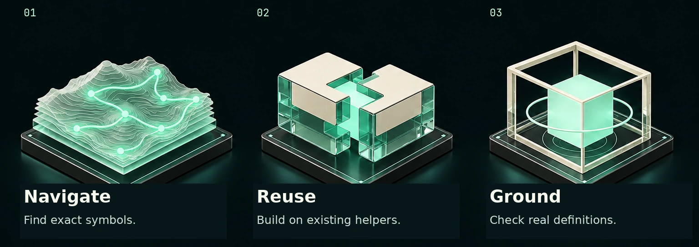
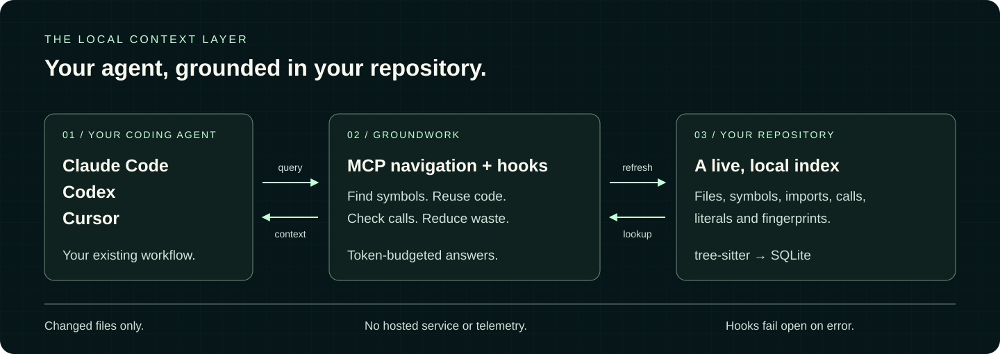

<p align="center">
  <picture>
    <source media="(max-width: 600px)" srcset="docs/assets/groundwork-hero-mobile.webp">
    
  </picture>
</p>

<h1 align="center">Less searching. More building.</h1>

<p align="center">
  A live, local map of your codebase for coding agents.<br>
  Find the right symbol. Reuse the right helper. Call code that actually exists.
</p>

<p align="center">
  <strong>Claude Code · Codex · Cursor</strong><br>
  TypeScript · JavaScript · Python &nbsp; / &nbsp; Node.js 22+ &nbsp; / &nbsp; MIT
</p>

<p align="center">
  <a href="#install"><strong>Get started</strong></a> ·
  <a href="#what-it-does">Why Groundwork</a> ·
  <a href="#see-a-real-check">See a real check</a> ·
  <a href="#how-it-works">How it works</a> ·
  <a href="#learn-more">Docs</a>
</p>

---

Your agent can write code. **Groundwork helps it understand the code you already have.**

Instead of filling the context window with grep results and whole files, the agent gets a ranked map, precise symbol reads, and existing code to reuse. Hooks keep that map current and check new calls against real definitions as the agent works.

**No hosted service. No telemetry. No network access at runtime.**

## Install

Requires **Node.js 22 or later**. Groundwork is **not published to npm yet**; install from source:

```sh
git clone https://github.com/ADITYADEV4145/GroundWork.git
cd GroundWork
npm ci
npm run build
npm link
```

Then, **from the repository you want your agent to work in**:

```sh
gw init       # build the local index in .groundwork/
gw setup      # preview project-level changes, then confirm
```

Restart your agent after setup. Codex asks you to trust the new hooks once, under `/hooks`.

Want to see exactly what setup would do first?

```sh
gw setup --dry-run
```

<details>
<summary><strong>Setup options, changed files, and removal</strong></summary>

| Flag | Effect |
| --- | --- |
| `--agent claude,codex,cursor` | Set up only these agents. By default, setup detects installed agents. |
| `--profile minimal\|standard\|strict` | Choose guard behavior. See [Profiles](#profiles). |
| `--dry-run` | Show the plan without writing anything. |
| `--yes` | Apply without asking; required when there is no terminal. |
| `--command "<cmd>"` | Choose how agents launch Groundwork; default: `gw`. |
| `--remove` | Remove what setup added, preserving unrelated settings. |

Setup writes project-level integration files for the agents you select: `.claude/settings.json`, `.mcp.json`, `.codex/hooks.json`, `.codex/config.toml`, `.cursor/hooks.json` and `.cursor/mcp.json`. It preserves existing settings. A selected profile is stored in `.groundwork/config.json`.

To uninstall the integrations, run `gw setup --remove`. To remove the local index and state too, delete `.groundwork/` afterward.

</details>

<details>
<summary><strong>Claude Code plugin and other MCP clients</strong></summary>

After installing from source, these integrations use the `gw` already on your PATH; npm publication is not required:

- **Claude Code plugin:** `/plugin marketplace add ADITYADEV4145/GroundWork`, then `/plugin install groundwork`.
- **Any MCP client:** run `gw mcp` as a stdio server from the repository root.

The npm package itself is still unpublished, so do not use `npx groundwork-agent` or `npm install -g groundwork-agent` yet.

</details>

## What it does

<picture>
  <source media="(max-width: 600px)" srcset="docs/assets/groundwork-workflow-mobile.webp">
  
</picture>

### One skill. Three better habits.

| Instead of… | Groundwork helps your agent… |
| --- | --- |
| **Searching in circles** — grep loops, whole-file reads, re-reading unchanged code | Navigate a ranked repository map and read just the symbols it needs, within a token budget. Claude Code's read guard catches repeat reads of unchanged ranges. |
| **Writing the same helper twice** — new names for code you already have | Find similar code first and choose `REUSE`, `EXTEND` or `NEW because …`. The change gate flags clones, duplicate constants and files, and code left dead by a change. |
| **Calling code that sounds right** — invented imports, members or arguments | Check edited calls against the index, suggest real definitions, and run the same grounding checks explicitly with `gw verify` or `gw check`. |

Waste guards also catch repeated commands, suggest more focused exploration, and trim noisy command output while retaining failures and a full local log. See [waste guards](docs/waste-guards.md) for the agent-specific behavior and limits.

**Languages:** TypeScript, JavaScript (including JSX and CommonJS), and Python. Other files fall back to the agent's normal tools.

## See a real check

An agent imports `formatCurrency`, but the module exports `formatPrice`. It also passes two arguments to a one-argument function. Groundwork reports both, with the real signature:

```text
$ gw check
BLOCK grounding (unknown-export): label.ts:1
Why: 'formatCurrency' is not exported in money.ts. Did you mean formatPrice (money.ts:1, formatPrice(cents: number): string)?
Fix: Use formatPrice (money.ts:1): formatPrice(cents: number): string.

BLOCK grounding (arity): label.ts:3
Why: formatPrice() takes 1 argument, got 2 — formatPrice(cents: number): string (money.ts:1).
```

**Not a plausible guess: a lookup against your repository.** `gw check` exits with code 1 on BLOCK findings, so you can also use it as a CI gate.

## How it works

<picture>
  <source media="(max-width: 600px)" srcset="docs/assets/architecture-mobile.svg">
  
</picture>

1. **Map once.** `gw init` parses the repository with tree-sitter and stores files, symbols, imports, calls, literals and fingerprints in SQLite (`node:sqlite`, with a `sql.js` fallback).
2. **Navigate precisely.** MCP tools answer with ranked, token-budgeted context. [SKILL.md](SKILL.md) teaches the agent to look for existing code before writing.
3. **Stay current.** Edit hooks reparse changed files, provide grounding notes and run the duplicate gate at Stop. Errors and timeouts fail open so the agent can continue.

### MCP tools

| Tool | What your agent gets |
| --- | --- |
| `repo_map` | A ranked directory tree with top symbols per file; narrow by path. |
| `find_code` | Symbols matching a name or description, with signatures. |
| `outline` | A file's symbols and signatures without their bodies. |
| `read_symbol` | One symbol's source, not the whole file. |
| `callers` / `callees` / `where_used` | Who calls a symbol, what it calls, and its references. |
| `find_similar` | Existing code to consider before writing something new. |
| `verify_calls` | Whether snippet imports and calls exist, and their argument counts. |
| `index_status` | Index freshness and size. |

Each answer has a token budget. Oversized answers are cut short with a way to fetch the rest.

### Agent support

The map is shared; hook capabilities differ.

| Capability | Claude Code | Codex | Cursor |
| --- | --- | --- | --- |
| MCP navigation and reuse tools | Yes | Yes | Yes |
| Index refresh and grounding notes after edits | Yes | Yes | Yes |
| Unchanged-file read guard | Yes | — | — |
| Automatic noisy-command wrapping | Yes | — | — |
| Stop findings in `standard` | Warnings | Warnings | Not shown |
| Stop gate in `strict` | Once per new finding set | Once per new finding set | Once per new finding set |

Use `gw run -- <cmd>` for explicit output trimming, or `gw check` for explicit change checks, regardless of agent. Cursor's Stop hook cannot show a warning without blocking; use `strict` or run `gw check` yourself there.

## Profiles

Start with `standard`. Tighten the Stop gate only when you want it.

| Profile | What runs | Stop behavior |
| --- | --- | --- |
| `minimal` | Navigation and the read guard where supported. | No duplicate gate. |
| `standard` **(default)** | Adds Reuse First, grounding notes and waste guards. | Findings are warnings; Cursor does not display Stop warnings. |
| `strict` | The same checks as `standard`. | Blocks once per new set of BLOCK findings in a session. |

Choose a profile during setup:

```sh
gw setup --profile strict
```

Or edit `.groundwork/config.json`. Explicit settings override profile defaults:

```json
{
  "profile": "standard",
  "grounding": { "enabled": true },
  "guards": {
    "repeatCommand": { "enabled": false },
    "explorationHint": { "threshold": 20 }
  }
}
```

Commit `config.json` to share your team's preferences. Everything else in `.groundwork/` is git-ignored.

> The profile controls the **Stop gate**, not every possible intervention. Read and repeat-command guards can deny redundant actions in the profiles where they are enabled; each has an override.

## Commands

| Command | What it does |
| --- | --- |
| `gw symbols <query>` / `gw show <symbol>` | Search symbols; show a signature, callers and callees. |
| `gw similar "<description>"` | Find existing code to reuse. |
| `gw check [--base <ref>]` | Check changed code for duplicates and grounding errors; exit 1 on BLOCK. |
| `gw verify [files...]` | Check grounding alone; exit 1 on definite errors. |
| `gw run -- <cmd>` | Keep the full command log locally and print a trimmed summary. |
| `gw report` | Show session guard activity and estimated savings. |
| `gw refresh` / `gw stats` | Refresh the index or inspect its contents. |
| `gw doctor` / `gw selftest` | Check the environment or run acceptance checks. |

Every command accepts `--json`.

## Accuracy

**Useful guardrails, with explicit limits.**

| Check | What is measured | What not to assume |
| --- | --- | --- |
| Duplicate BLOCK findings | 95% precision on the labeled duplicate corpus; 100% recall for exact copies and 96% for renamed copies. | These are planted examples, not production-repository results. Heavily rewritten clones may be warnings or missed. |
| Grounding | Resolves 99% of internal imports in this repository. | Dynamic dispatch, computed member names and external packages are skipped, not verified. |

See [reuse methodology](references/reuse.md) and [grounding behavior](references/grounding.md). These figures are not a claim about end-to-end token savings.

## Privacy and security

- **Local state:** the index, logs and session state stay in your repository's `.groundwork/`.
- **Offline runtime:** there is no telemetry or hosted inference. The optional `gw init --embeddings` command downloads a local model only when explicitly requested; similarity search also works without it.
- **Your permissions:** hooks run as your user. They inspect agent actions and may wrap supported noisy commands with `gw run`; they are not an autonomous command runner.
- **Fail open:** hook errors and timeouts let the agent continue. Explicit CLI checks still return nonzero on findings.

Read [SECURITY.md](SECURITY.md) for hook behavior and audit details.

## FAQ

<details>
<summary><strong>Does it slow my agent down?</strong></summary>

Hooks usually answer in milliseconds and have a 2-second dispatch budget. If a hook errors or times out, the action goes ahead. The index refreshes changed files rather than reparsing the whole repository.

</details>

<details>
<summary><strong>What if a guard is wrong?</strong></summary>

Retry the exact read once, rerun a command with `GW_FORCE=1`, or mark a deliberate duplicate with `// groundwork: allow-duplicate <reason>`. Overrides are logged so you can tune the configuration. See [troubleshooting](references/troubleshooting.md).

</details>

<details>
<summary><strong>Will it block my agent?</strong></summary>

The duplicate Stop gate blocks only in `strict`, and never twice for the same finding set in a session. Read and repeat-command guards can independently deny redundant actions; use the overrides above when the repetition is intentional.

</details>

<details>
<summary><strong>Can I use it without embeddings?</strong></summary>

Yes. `find_similar` works without a downloaded model. Embeddings are optional and run locally after the explicit model download.

</details>

<details>
<summary><strong>How do I remove it?</strong></summary>

Run `gw setup --remove` to remove the integrations, then delete `.groundwork/` to remove local state.

</details>

## Learn more

| Start here | Go deeper |
| --- | --- |
| [The agent skill](SKILL.md) — the protocol the agent follows | [Navigation](references/navigation.md) — map and symbol tools |
| [Reuse First](references/reuse.md) — reuse decisions and the duplicate gate | [Grounding](references/grounding.md) — how call verification works |
| [Waste guards](docs/waste-guards.md) — repeat reads, commands and output | [Troubleshooting](references/troubleshooting.md) — common fixes |
| [Security](SECURITY.md) — local behavior and auditing | [Contributing](AGENTS.md) — development commands and extension points |

To work on Groundwork itself: `npm test`, `npm run typecheck`, `npm run build`, and `npm run selftest -- --through 5`.

---

<p align="center">
  <strong>Give your agent solid ground.</strong><br>
  Built by <a href="https://github.com/ADITYADEV4145">Aditya</a> · <a href="LICENSE">MIT licensed</a><br>
  <sub>The generated illustrations are conceptual artwork, not product screenshots.</sub>
</p>
